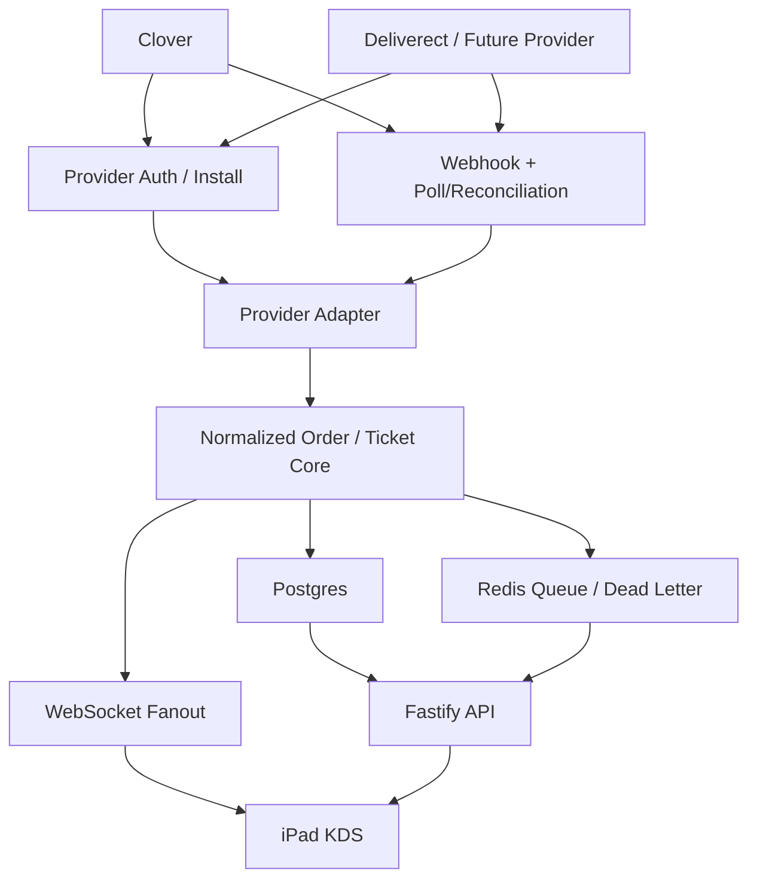

# Multi-Provider KDS Roadmap

> **Status:** current — strategy roadmap. **Update 2026-06-18:** Square is now a live second provider (catalog + orders→KDS shipped, PRs #764/#765), so the provider-adapter model here is proven by a real non-Clover POS — "Clover-first" below describes the near-term history, not a current constraint. Deliverect remains the next candidate adapter.

This document is the strategy roadmap for building Example Kitchen KDS toward a mature third-party KDS architecture while staying Clover-first in the near term.

It is written so a new Codex window can read it standalone and begin useful work immediately.

> Paths refreshed for the `apps/kds-api` + `packages/db-kds` monorepo layout (post-rename).

## Product stance

Current product stance:

- Clover was the first production provider; **Square is now a live second provider** (catalog + orders→KDS, PRs #764/#765).
- Clover is not the product's internal shape.
- The backend is the integration hub and source of truth for clients.
- The iPad app is a first-party KDS client of our backend, not a direct POS integration client.
- The architecture must support Deliverect and future providers without rewriting the KDS core.
- Deliverect route/config support already exists in the repo, but it is not yet the production proof of the provider-adapter model.

In one line:

`provider -> provider adapter -> normalized order/ticket model -> DB + queue + realtime -> iPad KDS`

## Target architecture



### Repo mapping

- `apps/kds-api`
  Owns provider auth, webhook verification, reconciliation, normalization, sync orchestration, outbox/dead-letter handling, and realtime fanout.
- `packages/contracts`
  Owns provider-neutral DTOs for clients and shared server contracts.
- `packages/db-kds`
  Owns persistent data model and migration history.
- `ios/Packages/YRCore`
  Owns stable app-domain contracts and protocol boundaries.
- `ios/Packages/YRBoard`
  Owns client composition over API, persistence, outbox, and realtime.
- `ios/Packages/YRUI`
  Owns KDS presentation only.

## Non-negotiable architecture rules

1. The server remains the source of truth for all clients.
2. iPad does not hold provider tokens and does not call provider APIs directly.
3. Provider DTOs and webhook shapes do not leak into `YRUI`, `YRBoard`, or shared app-facing contracts.
4. Every provider integration must support both event-driven ingest and a fallback reconciliation path.
5. Every provider action from the KDS must be recorded internally before attempting provider write-back.
6. Every provider integration must expose operational health: auth, webhook, reconciliation, sync failures, and dead letters.

## Delivery roadmap

The roadmap is intentionally staged so we do not over-abstract before the product is real.

### Stage 1 — Clover production hardening

Goal:
Make Clover production-safe as the first provider.

Required outcomes:

- OAuth install flow is the production path.
- Expiring access token refresh and recovery work reliably.
- Webhooks are verified, normalized, deduplicated, and queued.
- Reconciliation fills webhook gaps without masking webhook health.
- Dead letters and retry visibility exist for sync failures.
- Provider write-back is isolated to Clover-specific code paths.

Primary owning areas:

- `apps/kds-api/src/lib/clover-client.ts`
- `apps/kds-api/src/routes/clover.ts`
- `apps/kds-api/src/jobs/reconciliation.ts`
- `apps/kds-api/src/worker.ts`
- `packages/db-kds/prisma/schema.prisma`

Definition of done:

- Clover can be installed into a merchant account without manual token copy/paste.
- New or changed orders appear on the iPad through backend ingest only.
- Token expiration does not break service silently.
- Operational errors are inspectable in the backend.

### Stage 2 — Formal provider adapter boundary

Goal:
Make the backend explicitly provider-pluggable without pretending all providers are identical.

Required additions:

- A provider adapter interface in `apps/kds-api` covering:
  - auth/install capability
  - webhook parsing/verification
  - fetch full order
  - normalize inbound payload to internal order model
  - push outbound fulfillment/state
  - reconciliation fetch
- Clover moved fully behind that interface.
- Provider-neutral core service orchestrates:
  - enqueue
  - fetch
  - normalize
  - persist
  - publish realtime event

Suggested shape:

```ts
interface ProviderAdapter {
  provider: "clover" | string;
  parseWebhook(payload: Record<string, unknown>, headers: Record<string, unknown>): ParsedProviderEvent[];
  fetchOrder(context: { merchantId: string; orderId: string }): Promise<Record<string, unknown>>;
  normalizeOrder(raw: Record<string, unknown>, merchantId: string): Promise<NormalizedOrder>;
  reconcile(context: { merchantId: string; modifiedSince: Date }): Promise<Array<{ orderId: string }>>;
  pushFulfillment(context: ProviderFulfillmentContext): Promise<void>;
}
```

Definition of done:

- The sync pipeline can operate on an adapter rather than on Clover-specific calls.
- Adding a second provider does not require changes in iOS packages.

### Stage 3 — Reliability and operator tooling

Goal:
Add the operational features expected from a serious KDS system.

Required outcomes:

- Per-merchant integration status endpoint includes:
  - auth status
  - last webhook time
  - last reconciliation time
  - dead-letter count
  - degraded status reason
- Replay flow for dead-lettered order sync jobs.
- Structured audit trail for:
  - inbound provider events
  - normalized sync
  - KDS actions
  - outbound provider write-back
- Explicit webhook degraded and auth degraded states.

Suggested implementation areas:

- `apps/kds-api/src/routes/clover.ts`
- `apps/kds-api/src/lib/ticket-serializer.ts`
- a new provider operations/admin route group
- possible new audit table(s) in `packages/db-kds`

Definition of done:

- An operator can tell whether the provider is healthy without reading raw logs.
- Failed jobs can be replayed intentionally.

### Stage 4 — KDS client maturity

Goal:
Keep the client provider-neutral and operationally robust.

Required outcomes:

- `YRBoard` consumes only backend snapshots, actions, and realtime updates.
- Retry/degraded states surface to the app in provider-neutral terms.
- UI supports operator feedback for degraded provider state.
- Audio, printing, and board actions stay decoupled from provider shape.

Definition of done:

- The iPad can remain unchanged when backend provider adapters evolve.

### Stage 5 — Harden Deliverect as the second-provider proof

Goal:
Turn the existing Deliverect API surface into a real non-Clover provider path that proves the abstraction.

Current repo status:

- `apps/kds-api` already exposes Deliverect registration, order, product, and order-status routes.
- `apps/kds-api/src/config.ts` already reads Deliverect API URLs and webhook signature settings.
- The current route surface still needs production hardening before it should be treated like the Clover path.

Required outcomes:

- Deliverect ingest goes through the same provider adapter boundary as Clover.
- Deliverect webhooks are verified, normalized, deduplicated, queued, and observable.
- Operator health shows auth/webhook/reconciliation/sync state for Deliverect.
- Failed Deliverect sync jobs can be replayed intentionally.
- iPad and browser KDS clients continue to consume provider-neutral tickets only.

Definition of done:

- Deliverect can ingest orders, normalize them, publish to the same KDS board, and use the same operator tooling without leaking provider-specific shapes to clients.

## Recommended work order

Do not try to do every stage in parallel.

Recommended sequence:

1. Finish Clover production hardening.
2. Introduce the formal provider adapter boundary.
3. Add operator diagnostics and replay tools.
4. Polish client degraded-state handling.
5. Harden Deliverect as the second-provider proof path.

## Codex operating model

Use Codex in a commander/worker pattern.

### Default setup

- Keep one main thread as the commander thread.
- Use the commander thread for:
  - priority decisions
  - architecture review
  - task slicing
  - integration review
  - final verification
- Use one execution thread at a time for focused implementation.
- Add a second execution thread only when work is truly independent.

### Subagent policy

Subagents are opt-in. Use them only when the request explicitly calls for subagents, delegation, or parallel agent work.

Good subagent work in this repo:

- one agent maps provider adapter seams while another maps operator-health gaps
- one agent reviews auth/security risk while another reviews test coverage
- one agent summarizes iOS package boundaries while another summarizes backend sync flow

Poor subagent work in this repo:

- two agents editing `apps/kds-api/src/lib/sync-order.ts`
- one agent writing code while another edits the same route tests
- delegating the immediate blocking step that the commander needs before it can continue

If subagents are used, the commander must define:

- exact scope and write ownership for each agent
- files or modules the agent must not touch
- validation expected from each agent
- how results will be merged back into one final patch or decision

For this repo, good parallel pairs are:

- `YRUI` polish + backend provider work
- provider adapter refactor + operator diagnostics docs

Bad parallel pairs are:

- two threads both editing `apps/kds-api/src/lib/sync-order.ts`
- two threads both editing the same `YRUI` files

### Worktree policy

Do not use worktrees by default during rapid UI iteration.

Use a separate worktree when:

- one task is mostly `ios/Packages/YRUI`
- another task is mostly `apps/kds-api` or `packages/db-kds`
- a risky refactor should be isolated from current product work
- you want a clean reviewable branch for a broad backend migration

Do not use a worktree when:

- you are repeatedly adjusting the same small cluster of UI files
- the overhead of switching and rebuilding is larger than the implementation itself

## How to start Codex work

Every serious Codex task should include five things:

1. Goal
2. Allowed scope
3. Explicit non-goals
4. Validation to run
5. Deliverable shape

### Task template

Use this exact structure:

```text
Goal:
Implement <specific outcome>.

Scope:
Only edit <paths/modules>.

Do not touch:
Do not modify <paths/modules/behavior>.

Validation:
Run <tests/build commands>.

Deliverable:
Make the code changes, summarize the architecture impact, and note any follow-up risk.
```

### Good task examples

#### Example 1 — Clover hardening

```text
Goal:
Implement merchant-level Clover auth degradation reporting and replay support for dead-lettered sync jobs.

Scope:
Only edit apps/kds-api and packages/db-kds.

Do not touch:
Do not modify ios/Packages/* or shared client contracts unless strictly required by the backend response shape.

Validation:
Run pnpm build and pnpm --filter @rop/api test.

Deliverable:
Make the code changes, add tests, and explain the new operator-facing states and replay flow.
```

#### Example 2 — Provider adapter boundary

```text
Goal:
Refactor the backend sync pipeline so Clover sits behind a formal provider adapter interface without changing iPad behavior.

Scope:
Only edit apps/kds-api and packages/contracts if required for backend-only types.

Do not touch:
Do not modify ios packages, YRUI, or board presentation logic.

Validation:
Run pnpm build and pnpm --filter @rop/api test.

Deliverable:
Implement the refactor, preserve current behavior, and document the adapter seam and remaining Clover-specific code.
```

#### Example 3 — UI polish

```text
Goal:
Polish the iPad empty-state and ticket-board shell for 11-inch and 13-inch landscape layouts.

Scope:
Only edit ios/Packages/YRUI.

Do not touch:
Do not modify YRBoard, YRCore, networking, persistence, or realtime packages.

Validation:
Run swift test --package-path ios/Packages/YRUI and describe what should be checked in the next simulator screenshot.

Deliverable:
Make the visual improvements and summarize layout, typography, and operator-feedback changes.
```

## Definition of ready for a Codex task

A task is ready when:

- it has a single concrete goal
- the owning modules are known
- the non-goals are explicit
- the validation command is named
- the task can finish in one reviewable patch set

If the work sounds like "redesign the whole architecture," it is too large. Split it.

## Definition of done for a Codex task

A task is done when:

- the targeted behavior exists
- the requested validation ran or a blocker was clearly reported
- the summary identifies remaining risks
- unrelated files were not swept into the change

## Immediate next tasks for this repo

Recommended next queue:

1. Add provider integration health and replay endpoints in `apps/kds-api`.
2. Extract a formal provider adapter seam in `apps/kds-api`.
3. Define provider-neutral outbound fulfillment orchestration.
4. Surface degraded backend/provider state cleanly to `YRBoard`.
5. Harden the existing Deliverect route surface into the second-provider proof path.
6. Continue `YRUI` polish in a separate UI-focused thread or branch.

## Commander checklist for each day

At the start of a session:

1. Decide the single primary outcome for the day.
2. Decide whether the day is UI-heavy or backend-heavy.
3. If UI-heavy, keep one thread and avoid worktrees unless a backend thread is truly independent.
4. If backend-heavy with parallel work, isolate the second stream in a worktree.
5. Give Codex one scoped task at a time.
6. Review the diff before moving to the next task.

At the end of a session:

1. Capture what changed.
2. Capture what remains risky.
3. Capture the next smallest useful task.

That discipline matters more than adding more Codex threads.
